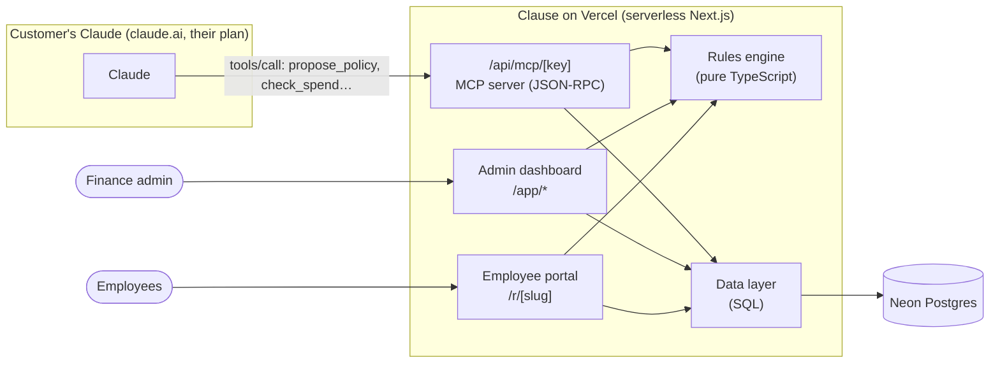

# Clause — Architecture & Implementation Notes

**Live prototype:** https://clause-zeta.vercel.app · **MCP endpoint:** `https://clause-zeta.vercel.app/api/mcp/ck_demo_northwind_7f3k`

Clause has one design rule: **Claude thinks, Clause enforces.** The customer's own Claude does the work that needs intelligence (reading a policy document and writing rules and test cases). Clause does everything that has to be reliable, shared and permanent (storing, testing, versioning, enforcing and auditing). There is no AI model, SDK or API key anywhere in this codebase.

## 1. System overview



| Layer | Technology | Where |
|---|---|---|
| UI | Next.js 16 App Router, React 19, Tailwind CSS v4, Inter | `src/app`, `src/components` |
| Mutations | Next.js Server Actions (no separate REST API for the UI) | `src/app/actions.ts` |
| Claude integration | MCP server written by hand: Streamable HTTP, stateless JSON-RPC | `src/lib/mcp.ts`, `src/app/api/mcp/[key]/route.ts` |
| Business logic | Deterministic rules engine: pure functions with no I/O | `src/lib/engine.ts` |
| Data access | Raw SQL through `postgres.js` (prod) / PGlite (local) | `src/lib/db.ts`, `src/lib/store.ts` |
| Auth | HMAC-signed session cookie, scrypt password hashes (Node `crypto`) | `src/lib/auth.ts`, `src/lib/password.ts` |
| Hosting | Vercel Hobby (free) + Neon Postgres (free) | — |

## 2. The three core flows

**A. Claude drafts a policy (MCP)**
1. The admin asks Claude: *"Set up the sample policy in Clause."*
2. Claude calls `get_workspace`, then `get_sample_policy` (or reads the user's own PDF), then `propose_policy` with structured rules and test cases.
3. Clause normalises the input, saves it as a **draft** (never live), and returns a report:
   - validation errors and warnings
   - test results
   - the diff against the live version
   - **an impact replay**: every recent real request re-evaluated under the draft
4. If any test fails, the response tells Claude what failed, and Claude fixes the draft and calls again. **This feedback loop is the key design idea:** the tests are deterministic, so Claude can correct itself.

**B. A human reviews and publishes (web)**
1. The Policy page shows the draft as plain sentences, with a one-click Edit on each rule.
2. Every save re-runs the tests and the replay.
3. Publish is blocked while there are errors or failing tests.
4. Publishing archives the previous version, so the history is kept.

**C. An employee asks "can I expense this?" (web, no Claude)**
1. The portal form previews the decision as you type, through a Server Action.
2. On submit, the engine evaluates against the **published** version and stores the full decision, including its trace and the version number.
3. The outcome is auto-approved, blocked, or sent to a Manager, Finance or the CFO.

## 3. Rules engine (`src/lib/engine.ts`)

A rule is data, not code:

```ts
{ id, clause: "4.1", title, quote /* verbatim policy text */, categories: ["hotels"],
  when: [{ field: "per_night", op: "gt", value: 250 }, { field: "city", op: "not_in", value: [...] }],
  action: "require_approval", approver: "manager", message }
```

- **Facts:** derived from a request: `amount`, `per_person`, `per_night`, `advance_days`, `cabin_class`, `city`, `has_receipt`, and **`month_to_date`**. The last one is a per-employee, per-category running total computed from history. It's state that Claude can't hold.
- **Matching:** a rule fires when its category matches and **all** of its conditions hold. Operators are `gt`, `gte`, `lt`, `lte`, `eq`, `neq`, `in`, `not_in` and `contains_any`. Text comparisons ignore case and match on word boundaries.
- **Resolution:** the most restrictive outcome wins (`block` > `require_approval` > `allow`), and the most senior approver wins (CFO > Finance > Manager). When no rule fires, the policy's default applies.
- **Explainability:** each decision stores every rule checked, whether each condition passed, and the actual value. The same input and version always give the same output.
- **Validation:**
  - unknown fields and invalid operators for a field's type
  - type mismatches
  - missing quotes
  - categories with no rules
  - **drift**: a rule's number that no longer appears in the policy text it quotes
- **Diff:** compares canonical JSON with sorted keys, because Postgres `jsonb` reorders keys.

## 4. MCP server (`src/lib/mcp.ts`)

- **Transport:** stateless Streamable HTTP. `POST` takes JSON-RPC (single or batched), `GET` and `DELETE` return 405, notifications return 202, and CORS is enabled. There are no sessions, so it runs on serverless functions at no cost per request.
- **Methods:** `initialize` (version negotiation, with the server's `instructions`), `tools/list`, `tools/call` and `ping`.
- **Tools:**
  - `get_workspace`, `get_sample_policy`, `check_spend` and `list_requests` (read-only)
  - `propose_policy`, `update_rule` and `remove_rule` (draft only)
  - `review_request` (only when the user explicitly asks)
- **Prompting through schemas:** the tool descriptions and JSON schemas carry the domain knowledge (how to split thresholds, write exceptions and write tests), so Claude produces valid rules without needing a manual.
- **Tenancy:** each workspace has a secret key in its URL path (`/api/mcp/<key>`). Claude can only draft; **only a signed-in human can publish.**

## 5. Data model (Postgres)

| Table | Purpose |
|---|---|
| `workspaces` | company, admin login (scrypt hash), MCP key, demo flag |
| `policy_versions` | `version`, `status` (draft / published / archived), `source` (claude / human), `policy jsonb` (rules + tests + defaults) |
| `requests` | employee, `input jsonb`, `decision jsonb` (with trace), `policy_version`, status, reviewer, note |
| `events` | activity feed and audit log: actor (claude / admin / employee / system), what happened, when |

- **Schema setup:** the schema is created on first boot and the demo workspace is seeded idempotently.
- **Demo reset:** the demo resets itself after 15 minutes of inactivity, so every reviewer starts clean.
- **One draft at a time:** each workspace has at most one draft and one published version.

## 6. Key decisions and trade-offs

| Decision | Why |
|---|---|
| A deterministic engine instead of an LLM at runtime | Finance needs reproducible, auditable decisions, and it brings the cost per decision to zero. |
| An MCP server written by hand instead of the SDK | About 400 lines, no transport state, fits serverless functions, and every behaviour is easy to follow. |
| Drafts plus human publish | Claude is powerful but not accountable, so a person always signs off. |
| Impact replay on real history | Turns "is this rule right?" into "here's who it affects", which is how finance teams actually decide. |
| Raw SQL instead of an ORM | Four tables, simple queries, and one fewer dependency and abstraction. |
| PGlite locally, Neon in production | Zero-setup local development with the same SQL dialect as production. |
| Live refresh by polling | A 2.5-second poll of a cheap "last change" stamp, so Claude's changes appear without websockets. |

## 7. Security notes and known limits (prototype)

- The MCP key in the URL acts as a bearer secret. A production version would use OAuth 2.1 (which MCP's authorisation spec supports) with per-user scopes.
- The employee portal is public by company slug. A production version would add SSO and employee-identity verification.
- Receipts are a yes/no flag. Receipt upload and matching against card transactions (for example Volopay card feeds) is the natural next step.
- Request references are sequential and kept simple. Result pages require the submitter's email in the link.

## 8. Run locally

```bash
npm install
npm run dev   # http://localhost:3000 — embedded Postgres, auto-seeded demo
```

Production needs `DATABASE_URL` (Postgres) and `SESSION_SECRET`.
